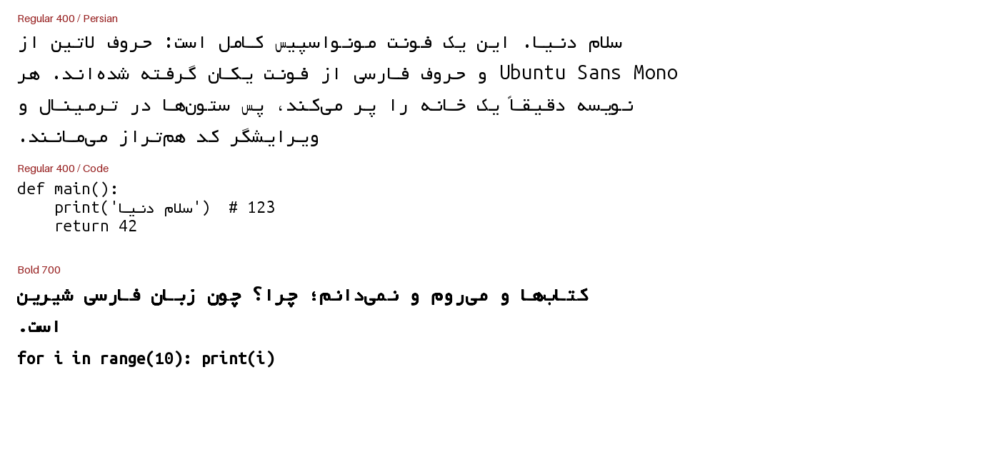
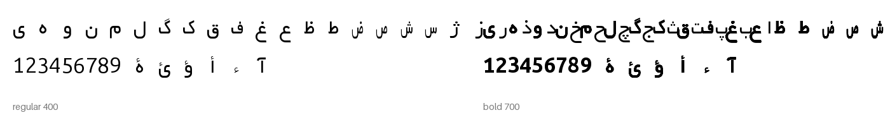
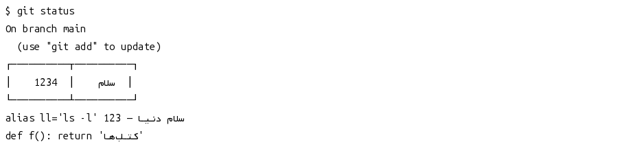

# Monospace Yekan Farsi

A complete monospace font family for **Persian + Latin**:

* **Latin, Greek, Cyrillic, symbols** — [Ubuntu Sans Mono](https://fonts.google.com/specimen/Ubuntu+Sans+Mono)
* **Persian / Arabic** — [Far Yekan](https://fa.wikipedia.org/wiki/%D9%81%D8%A7%D8%B1_%DB%8C%DA%A9%D8%A7%D9%86), re-spaced onto Ubuntu's cell
* **Weights** — Regular 400 and Bold 700, static TTF

Every glyph occupies exactly **560 / 1000 em**, so Persian and Latin lines share the
same grid. That is what makes this font usable in terminals, editors and anywhere
columns have to line up.

<div dir="rtl">

**فونت مونواسپیس یکان فارسی** — حروف لاتین از Ubuntu Sans Mono و حروف فارسی از
یکان، هر دو روی یک شبکهٔ ۵۶۰ از ۱۰۰۰. هر نویسه دقیقاً یک خانه، با جای‌گذاری
واقعی اعراب و علامت سؤال فارسیِ برگشته.

</div>



## Why this exists

A terminal that falls back to a proportional Persian font (Vazirmatn, IRANSans,
Yekan…) breaks alignment. A monospaced fallback (DejaVu Sans Mono) is usually
either missing Persian glyphs or has poorly matched weights. This font puts a
real Persian design inside the exact metrics of the Latin font you are already
using.

## Design notes

* **One cell, one character.** All letters, digits, punctuation and symbols are
  560 units wide; combining marks are zero-width. `post.isFixedPitch = 1`.
* **The letters are not squeezed.** Far Yekan's letter bodies keep their designed
  proportions. Only the baseline connector bar (the horizontal stroke at
  `y = 0…180` in the original, `0…88` here) is lengthened or shortened so that it
  reaches the cell edge. Stroke weight, contrast and curves survive unchanged.
  Wide isolated forms are condensed only as much as the cell requires.
* **Real mark positioning.** Far Yekan has no GPOS table; harakat were placed by
  fixed offsets and drifted once letters moved. The build adds a MarkBasePos
  lookup with anchors derived from each letter's body, so fatha/kasra/shadda sit
  on the letter they belong to.
* **`؟` is a true mirror.** U+061F is generated by mirroring Ubuntu's `?`, so the
  Persian question mark matches the Latin one in weight and shape.
* **Digits.** `۰۱۲۳۴۵۶۷۸۹` and `٠١٢٣٤٥٦٧٨٩` use the Latin digit design. Yekan's own
  digits are drawn at ~0.31 em, which looks like subscript next to a monospace
  letter; using one digit design keeps numbers uniform.
* **Arabic layout** (init/medi/fina, lam-alef ligatures, tatweel, ZWNJ/ZWJ) comes
  from Far Yekan's GSUB table. The Latin shaping features from Ubuntu (ligatures,
  stylistic sets, localized forms) are **not** carried over — the Arabic tables
  replace Ubuntu's GSUB. All Latin *glyphs* and metrics are unchanged.





## Coverage

| Block | Source |
|---|---|
| Basic Latin, Latin-1/Ext-A/B, IPA, Greek, Cyrillic | Ubuntu Sans Mono |
| General punctuation, currency, arrows, math, box drawing, blocks, geometric shapes | Ubuntu Sans Mono |
| Arabic (U+0600–06FF) incl. Persian letters, harakat, `، ؛ ؟ ـ` | Far Yekan + mirrored `?` |
| Arabic Presentation Forms A/B (U+FB50–FEFC) | Far Yekan |
| Arabic-Indic and Extended Arabic-Indic digits | Ubuntu Sans Mono digits |
| CJK, emoji, Hebrew | not included |

## Install

**Linux**

```bash
mkdir -p ~/.local/share/fonts
cp dist/MonospaceYekanFarsi-*.ttf ~/.local/share/fonts/
fc-cache -f
fc-match "Monospace Yekan Farsi"
```

Then select **Monospace Yekan Farsi** in your terminal/editor. For Pango/fontconfig
users who currently force a Persian fallback, remove that rule — this font already
contains Persian.

**macOS** — copy the TTFs to `~/Library/Fonts`.
**Windows** — right-click → *Install for all users*.

## Build from source

```bash
python3 -m venv .venv && . .venv/bin/activate
pip install -r requirements.txt
make            # builds dist/*.ttf
make check      # runs tests/qa.py on both weights
make specimen   # regenerates specimens/*.png
```

The two source fonts live in `sources/`. Everything is reproducible from them.

## Repository layout

```
sources/     UbuntuSansMono[wght].ttf, Far_Yekan.ttf
tools/       build.py (font compiler), specimen.py
tests/       qa.py (grid, coverage, shaping, joins, names)
dist/        built TTFs
specimens/   README images
```

## Known limitations

* **ZWNJ** (`می‌روم`): the word-final and word-initial forms each fill their cell,
  so a ZWNJ leaves only a narrow visual gap instead of a full cell. The text is
  shaped correctly; the gap is just small. Use a normal space where a wide gap is
  wanted.
* **Bold Persian is synthetic.** Far Yekan only has one weight; the Bold face
  emboldens the Persian outlines by a small outline dilation while the Latin side
  is genuine Ubuntu Sans Mono Bold. It matches well at text sizes but is not a
  separately drawn design.
* **No italic.** A slanted Persian design would need real drawing, not a shear.
* Latin OpenType features (fi/fl ligatures, `ss01`, `locl`, fractions) are not
  available; base Latin coverage and metrics are untouched.

## License

Released under the **SIL Open Font License 1.1** — see [OFL.txt](OFL.txt).

* Latin glyphs: Ubuntu Sans Mono, Copyright 2011–2023 Canonical Ltd.,
  originally under the Ubuntu Font Licence 1.0.
* Persian glyphs: Far Yekan, Copyright 2011 Abolfazl Seilsepour.
* Monospace conversion, mark positioning, mirrored `؟`, build system:
  Monospace Yekan Farsi project.

The reserved font name is “Monospace Yekan Farsi”. The name “Ubuntu” is a
registered trademark of Canonical Ltd. and is used here only to credit the
original Latin design.
